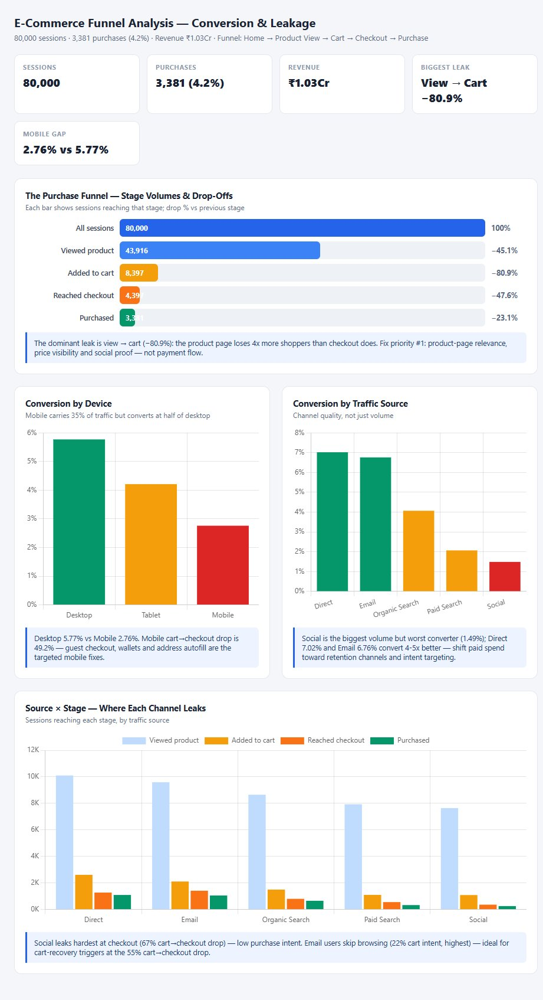

# 🛒 E-Commerce Funnel Analysis (SQL · Conversion · Dashboard)

**Business question:** *Where do 80,000 shopping sessions leak in the funnel, and which device or traffic source deserves the fix first?*

## ▸ Project Highlights

▸ Mapped the full purchase funnel for **80,000 sessions**: 55% view a product → 19% of viewers add to cart → 52% of carts reach checkout → **3,381 purchases (4.2% session conversion), ₹1.03Cr revenue**.

▸ Located the **biggest leak: view → add-to-cart, losing 80.9% of product viewers** — 4x larger than checkout leakage — pointing to product-page relevance and price display, not payment friction, as the first fix.

▸ Found the **mobile gap**: mobile carries 35% of traffic but converts at **2.76% vs 5.77% on desktop** — the same catalogue converts nearly half as well on mobile; cart→checkout drop is 49.2% on mobile vs 40.7% on desktop (guest checkout + wallet options target this).

▸ Ranked traffic sources by quality, not volume: **Social drives the most sessions but converts at only 1.49%** (worst checkout intent — 67% cart-to-checkout drop), while **Direct (7.02%) and Email (6.76%) convert 4-5x better** — reallocation of paid spend toward retention channels is the ROI move.

▸ Calculated **revenue per session** by source: Direct leads at ₹2.10/session vs Social ₹0.42/session — Social's ₹-bid spend needs intent-based targeting or retargeting, not more reach.

▸ Built a **source × stage leakage matrix in SQL** showing Email users skip the browse phase (highest cart-intent 22%) — the trigger for cart-recovery email journeys at the 55% cart→checkout drop.

## 📂 Structure

- `data/` — 80,000-row session dataset (CSV + SQLite `data.db`)
- `sql/queries.sql` — 7 analyses: funnel rates, stage drops, device & source conversion, leakage matrix, revenue efficiency
- `dashboard/` — interactive HTML dashboard (`index.html` + `agg_data.json`) + `screenshot.jpg`

## ▸ Key Insight

> The funnel does not leak evenly — **the product→cart stage loses 81% of shoppers**, mobile converts at half of desktop, and Social traffic converts at 1/5th of Direct. Fixing one stage (product page) and one segment (mobile checkout) is worth more than all remaining optimisations combined.

## ▸ Tools

SQL (SQLite) · Funnel analysis · Drop-off/leakage matrices · Channel-efficiency analysis · Interactive dashboard (Chart.js)
